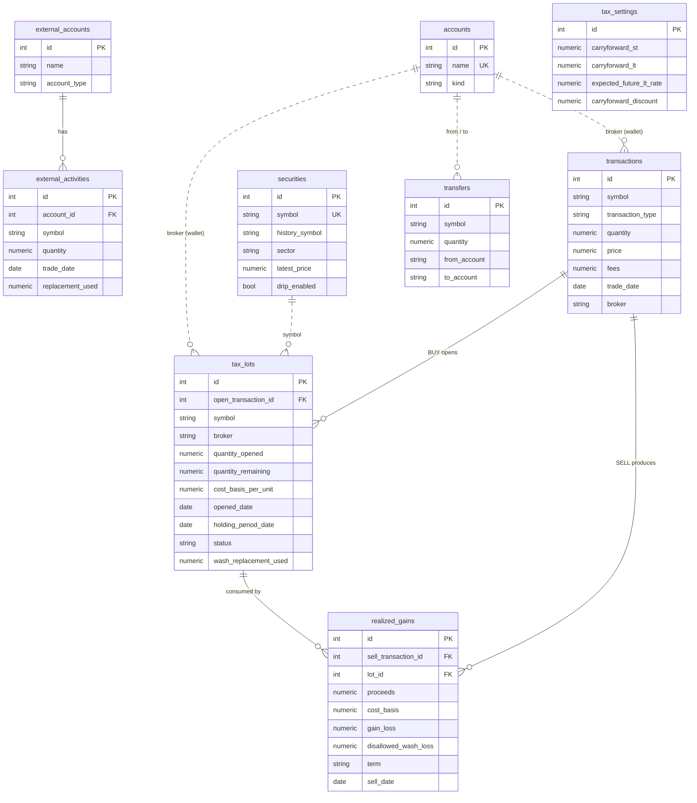

# HarvestIQ

HarvestIQ is a tax-loss harvesting engine for stock and crypto portfolios. It tracks holdings at the tax-lot level across multiple wallets, values them against live market prices, and generates an ordered plan of which lots to sell. A live dashboard shows the plan and updates it as prices move.

The backend runs as three processes: a FastAPI web server, a Celery worker, and a market-data streamer. They coordinate through Redis and PostgreSQL. This document describes how the backend works. The tax logic itself is documented in [docs/TAX_ENGINE.md](docs/TAX_ENGINE.md).

**Stack:** Python, FastAPI, PostgreSQL, SQLAlchemy, Alembic, Redis, Celery, WebSockets, Finnhub, yfinance, Groq, vanilla JS + Chart.js, pytest

---

## Architecture

```
   Finnhub (wss)                                           Browser dashboard
        │ trade frames                                    ▲  HTTP + WS /ws/prices
        ▼                                                 │
 ┌─────────────┐   PUBLISH "prices"    ┌─────────────┐  SUBSCRIBE  ┌─────────────┐
 │  streamer   │ ────────────────────▶ │             │ ──────────▶ │   FastAPI   │
 │  process    │                       │    Redis    │             │    (web)    │
 │             │   enqueue task (30s)  │             │  GET cache  │             │
 │             │ ────────────────────▶ │  broker     │ ◀────────── │             │
 └──────┬──────┘                       │  results    │  enqueue    └──────┬──────┘
        │                              │  cache      │                    │
        │                              │  pub/sub    │                    │
        │                              └──┬───────▲──┘                    │
        │                         consume │       │ SET tax_analysis      │
        │                                 ▼       │                       │
        │                              ┌──────────┴──┐                    │
        │                              │   Celery    │ ───▶ Groq (LLM)    │
        │                              │   worker    │                    │
        │                              └──────┬──────┘                    │
        │ UPDATE changed prices               │ read lots                 │ read/write
        ▼                                     ▼                           ▼
 ┌──────────────────────────────────────────────────────────────────────────────┐
 │                PostgreSQL: transactions · tax lots · realized gains          │
 └──────────────────────────────────────────────────────────────────────────────┘
```

| Component | Entry point | Role |
| --- | --- | --- |
| Web server | `app/main.py` | REST API, dashboard, `/ws/prices` broadcaster, transaction processing |
| Worker | `app/celery_app.py` | Harvest analysis and LLM explanations |
| Streamer | `app/price_stream.py` | Finnhub websocket client, price persistence, change notifications |
| Domain logic | `app/harvest.py` | Netting, plan generation, wash-sale rules (pure Python, no I/O framework imports) |
| Market data | `app/prices.py` | All outbound vendor calls |
| Models | `app/model.py` | SQLAlchemy models |

The processes don't share memory. They communicate only through Redis (messages, task queue, cached results) and Postgres (persistent state), so each one can be restarted independently. Imports point one way only: `main.py → celery_app.py → harvest.py → model.py`.

---

## Live price updates

**Ingestion.** The streamer keeps a persistent websocket connection to Finnhub and subscribes to every security in the database. The `on_message` handler writes each trade's price into an in-memory dict and does nothing else, so no database I/O happens on the socket's read loop.

**Persistence.** A background thread runs once a second. It compares the dict against the last values it wrote and issues `UPDATE`s only for symbols whose price changed. If anything changed, it publishes a message on the Redis `prices` channel. The message carries no prices. Subscribers read the current values from Postgres, so the database is the only source of price data.

**Broadcast.** At startup, the web server's ASGI `lifespan` opens a single Redis subscription and starts two tasks:

- a **listener**, which sets an `asyncio.Event` whenever a message arrives;
- a **broadcaster**, which waits on that event, clears it, builds the portfolio summary in a threadpool (the DB access is synchronous), sends it to all connected clients concurrently, then sleeps for a minimum interval (2s by default).

Since the event is a flag, any number of messages arriving during the sleep produce a single update. The summary is computed once per update regardless of how many clients are connected, and not at all when none are. The `/ws/prices` handler only registers the client, sends the current summary on connect, and waits on `receive()` to detect disconnects.

The event is created inside `lifespan` rather than at import time, because an `asyncio.Event` binds to the event loop that first awaits it. On shutdown, `lifespan` cancels and awaits both tasks, then closes the subscription and the Redis connection.

**Connection failures:**

| Failure | Handling |
| --- | --- |
| Finnhub connection drops | `run_forever(reconnect=5)` reconnects. Subscriptions belong to the connection, so `on_open` clears local state and re-subscribes every symbol. |
| Half-open connection | Ping every 20s with a 10s pong timeout. |
| Security added at runtime | New symbols are subscribed every 60s. Subscribing is idempotent. |
| Browser closes the tab | ASGI delivers the disconnect as a receive event, and the handler removes the client. |
| Slow or stalled client | Each send has a 5s timeout. Clients that exceed it are dropped. |
| Dashboard loses its socket | The client reconnects after 2s and receives the current summary immediately. |

---

## Background processing

Celery runs with Redis as both broker and result backend. There are two tasks, and they use different patterns.

**`run_tax_analysis` (compute and cache).** This task loads all open lots, computes harvest opportunities and the sequenced plan, and writes the result to the Redis key `tax_analysis`. The streamer enqueues it every 30 seconds, and `POST /tax-analysis/run` triggers it on demand. All reads (`GET /tax-analysis`, `GET /portfolio-summary`, and the websocket push) use the cache and never recompute. If the cache is empty, `GET /tax-analysis` returns `503`.

**`generate_harvest_explanation` (poll by job id).** `POST /harvest-explanations` enqueues an LLM call and returns `202 Accepted` with the job id and a `Location: /jobs/{id}` header. The client polls `GET /jobs/{id}`, which reads the task state from the result backend. The endpoint is a `POST` because each call costs money and should never be triggered by a prefetch or a retry.

Celery's JSON serializer can't encode `Decimal`. Tax rates are passed to tasks as strings and converted back inside the task, and cached results are encoded with `default=str`.

---

## Market data

`app/prices.py` is the only module that calls external market-data APIs. Every request has a 5s timeout and one retry with exponential backoff. Vendor failures raise `PriceUnavailable`, which the API returns as `502`.

Finnhub supplies live prices (websocket and REST `/quote`), and yfinance supplies historical daily bars. History is cached in Redis under `price_history:{symbol}:{days}` for one hour, and empty results are cached for 60s so a bad symbol doesn't call the vendor on every request. The two vendors use different symbols for the same instrument (`BINANCE:BTCUSDT` vs `BTC-USD`), so each security stores a canonical symbol and an optional history-vendor override.

---

## Data model

- **SQLAlchemy models are the schema definition.** Each table is a typed class in `app/model.py` (`Mapped[...]` columns), and every money and quantity column is `Numeric(20, 8)`, which reads back as Python `Decimal`.
- **Alembic turns model changes into migrations.** `alembic/env.py` points `target_metadata` at the models' `Base.metadata`, so `alembic revision --autogenerate` diffs the models against the live database and writes a versioned migration script. That gives 11 migrations in one linear chain.
- **PostgreSQL is only ever changed by migrations.** `alembic upgrade head` applies them in order, and the app never calls `create_all` against Postgres.
- **The app reaches Postgres through one engine per process.** `app/database.py` builds the engine and connection pool from `DATABASE_URL` and hands out sessions. The ORM turns queries into SQL, and inserts and updates are committed as one transaction per unit of work.
- **Tests skip Alembic.** They point the same models at in-memory SQLite and build the schema with `Base.metadata.create_all`.



Solid lines are foreign keys. Dotted lines are joins on a natural key (`symbol`, wallet name). `tax_settings` is a single-row table with no relationships.

How each process uses it:
- **Web:** session per request via a FastAPI dependency. The broadcaster opens its own session in a threadpool.
- **Streamer:** writes changed prices, commits, then publishes to Redis.
- **Worker:** bulk-loads lots and securities (no per-lot queries) and writes results to Redis.

| Table | Purpose |
| --- | --- |
| `transactions` | Every buy and sell as recorded |
| `securities` | Security master: symbol, history symbol, sector, latest price, dividend/DRIP settings |
| `tax_lots` | One row per purchase: quantity remaining, cost basis per unit, purchase date, holding-period date, wallet |
| `realized_gains` | One row per lot consumed by a sell: proceeds, basis, gain/loss, disallowed wash-sale loss |
| `accounts`, `transfers` | Wallets/brokerages, and lot moves between them that keep basis and dates |
| `external_accounts`, `external_activities` | Watch-only accounts (IRA, spouse) that count toward wash-sale windows |
| `tax_settings` | Carryforwards and planning parameters |

**Processing a sell.** `process_transaction` selects candidate lots for the symbol in the selling wallet (FIFO, HIFO, or the specific lot ids requested). It validates them and rejects an oversell, consumes the lots, writes one `realized_gains` row per lot, and applies any wash-sale basis adjustments to replacement lots. Intermediate steps use `flush()`, and everything is committed once at the end, so a sell either applies fully or not at all.

---

## API

The OpenAPI documentation is served at `/docs`.

- Creation returns `201`. Enqueued work returns `202` with a `Location` header.
- Errors use `{"detail": ...}`: `400` for invalid input such as unknown or closed lot ids, `502` for vendor failures, `503` for a cold cache.
- Money and quantities are serialized as strings.

| Endpoint | Purpose |
| --- | --- |
| `GET /harvest-plan` | Ordered, sized harvest plan |
| `GET /harvest-opportunities` | Per-lot opportunities with wash-sale / DRIP / seasoning flags |
| `GET /harvest-capacity` | Remaining harvestable loss |
| `POST /tax-analysis/run` · `GET /tax-analysis` | Enqueue a recompute / read the cache |
| `POST /harvest-explanations` · `GET /jobs/{id}` | Enqueue an LLM explanation / poll a job |
| `POST /transactions` · `POST /transactions/market` | Record a buy or sell |
| `GET /tax-lots` · `GET /realized-gains` | Lot and realized-gain records |
| `GET /portfolio` · `GET /portfolio-summary` | Holdings and summary totals |
| `WS /ws/prices` | Live summary updates |
| `/accounts` · `/transfers` · `/external-accounts` | Wallets, transfers, watch-only accounts |
| `/securities` · `GET /price-history/{symbol}` | Security master and price history |
| `GET` / `PUT /tax-settings` | Tax settings |

---

## Frontend

The dashboard is a single static page (`static/index.html`) written in vanilla JavaScript with no build step, served by FastAPI at `/dashboard`. Everything runs in the browser and talks to the backend over the same REST API and websocket documented above.

- **Initial load:** fetches each panel (plan, holdings, opportunities, realized gains, wallets, settings) from its own REST endpoint and renders it into the DOM. Values from the server are HTML-escaped before they are inserted.
- **Live updates:** opens a websocket to `/ws/prices` and repaints the summary from each pushed message, with no refetch. If the socket closes, it reconnects after 2s.
- **Executing a plan step:** each step has a two-click sell button (the first click arms it, the second sends). It posts a specific-lot market sell with the exact lot id from the plan, then triggers a recompute and reloads the panels from the cache.
- **AI explanation:** posts to `/harvest-explanations`, then polls `GET /jobs/{id}` every 1.5s until it sees `SUCCESS` or `FAILURE`, giving up after about 60s.
- **Charts:** Chart.js renders 90-day price history from `GET /price-history/{symbol}`, which is cached in Redis.
- **Settings:** the tax rates entered in the page are passed as query parameters on every analysis request, and settings forms write back through `PUT /tax-settings`.

---

## Configuration

| Variable | Default | Used by |
| --- | --- | --- |
| `DATABASE_URL` | `postgresql://localhost/harvestiq` | All processes (SQLAlchemy engine) |
| `REDIS_URL` | `redis://localhost:6379/0` | Web server and market-data layer |
| `DB_POOL_SIZE` / `DB_MAX_OVERFLOW` / `DB_POOL_TIMEOUT` | `10` / `20` / `10` | Connection pool sizing |
| `WS_MIN_PUSH_INTERVAL` | `2` | Minimum seconds between websocket pushes |
| `FINNHUB_API_KEY` | none | Streamer and spot quotes |
| `GROQ_API_KEY` | none | Worker (LLM explanations) |

The Celery broker URL in `app/celery_app.py` is currently fixed to the local Redis and doesn't read `REDIS_URL`.

---

## Testing

```bash
python3 -m pytest -q
```

- `tests/test_engine.py` has 63 tests. They use FastAPI's `TestClient` against in-memory SQLite and cover lot selection, netting, wash-sale enforcement, plan generation, transfers, and request validation.
- `tests/test_ws_prices.py` has 5 tests and requires Redis. They check that a price change triggers a push, that one computation serves multiple clients, that bursts are merged into one push, that no work happens when nobody is connected, and that disconnected clients are removed.

---

## Running locally

Requires Python 3.9+, PostgreSQL, Redis, and API keys for [Finnhub](https://finnhub.io/register) and [Groq](https://console.groq.com).

```bash
git clone https://github.com/mtjia6/harvestiq.git && cd harvestiq
python3 -m venv venv && source venv/bin/activate
pip install -r requirements.txt

createdb harvestiq
cat > .env <<'ENV'
GROQ_API_KEY=your_key_here
FINNHUB_API_KEY=your_key_here
ENV

alembic upgrade head
honcho start                                   # web + worker + streamer (Procfile)
curl -X POST localhost:8000/tax-analysis/run   # populate the analysis cache
python3 seed.py                                # optional demo portfolio
```

Dashboard: http://127.0.0.1:8000/dashboard · API docs: http://127.0.0.1:8000/docs

On macOS the worker runs with `--pool=solo`, because the default prefork pool crashes there.

---

## Limitations

- No authentication. All data belongs to a single shared user.
- Sells don't lock lot rows, so two concurrent sells of the same lot can both pass validation.
- The periodic recompute is a loop in the streamer process, not Celery Beat.
- Engine tests run on SQLite rather than Postgres.
- Tax rates are flat and user-supplied. See [docs/TAX_ENGINE.md](docs/TAX_ENGINE.md#tax-model-limitations).

*Educational project. Not tax, legal, or financial advice.*
